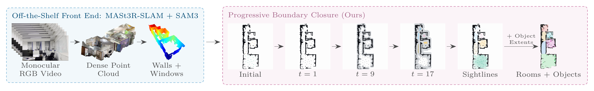
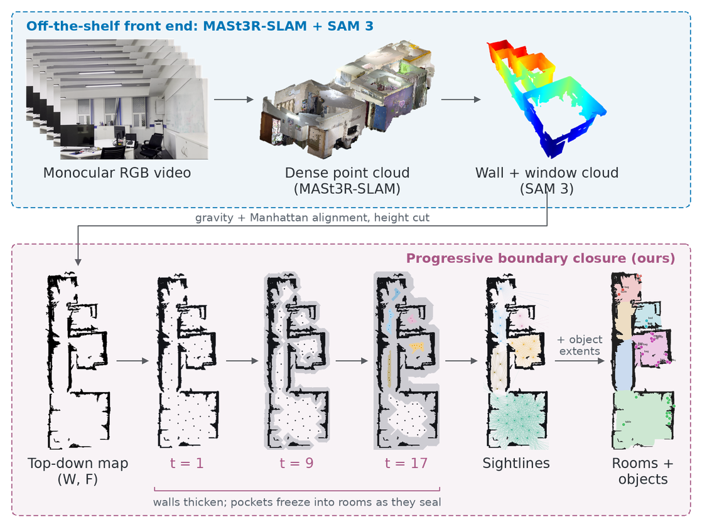

<div align="center">

# ProClosure: Hierarchical Room-Object Assignment using Progressive Boundary Closure from Monocular Video

**ICVGIP 2026**

Vinoth Kumar Muthuraj, Soumyadeep Banik, Kushal Sharma, Hardik Jain<br>
[CLARITY Lab](https://home.iitj.ac.in/~hardikjain/ClarityLab.html), IIT Jodhpur

[](https://arxiv.org/pdf/2609.12614)
[](MASt3R_SLAM_Setup.md)
[](requirement_pipeline.txt)
[](LICENSE%20.md)

[Paper (PDF)](https://arxiv.org/pdf/2609.12614) | [Supplementary (PDF)](Vinoth2026ProClosure-Supp.pdf) | [Citation](#citation) | [Installation](#installation) | [Usage](#usage)

</div>

<p align="center">
  
</p>

ProClosure recovers a room layer, and the objects inside it, from monocular RGB video.
The top-down boundary is thickened step by step, and each free-space pocket is declared a
room and frozen as soon as it seals; seeds then cast sightlines that label free space, and
each object takes the room holding most of its reconstructed extent. In the released method
the seeds are the recorded camera positions; the closure panels shown here were rendered with
the sampled-seed variant described in the supplementary material (Implementation Details).

## How it works

<p align="center">
  <picture>
    <source media="(prefers-color-scheme: dark)" srcset="media/workflow_dark.png">
    
  </picture>
</p>
<!-- TODO: name the capture shown in the animation and teaser. Provenance could not be
     verified from the repo: input_frames.png shows an office, while the reconstruction and
     maps show a multi-room home; the closure panels use sampled seeds (supplementary,
     Implementation Details), the final panel uses camera-pose seeds. -->

1. **Reconstruction and segmentation.** [MASt3R-SLAM](https://github.com/rmurai0610/MASt3R-SLAM)
   turns the video into keyframes with per-pixel 3D points, a dense cloud and a camera
   trajectory ([`mast3r_slam_main.py`](mast3r_slam_main.py)). [SAM 3](https://github.com/facebookresearch/sam3)
   segments every keyframe against a fixed prompt list; *wall* and *window* masks accumulate
   into the structural cloud, and every other mask becomes an object observation that a
   voxel-IoS tracker merges into persistent tracks ([`01_pipeline.py`](01_pipeline.py),
   [`object_tracker/`](object_tracker/)).
2. **Canonical projection.** The cloud is gravity- and Manhattan-aligned, cut at mid-height
   and rasterised into the binary top-down map (W, F); the full cloud gives the building
   footprint on the same grid (Phase A, `phase_a_pipeline` in
   [`02_room_detection.py`](02_room_detection.py)).
3. **Progressive boundary closure, then object placement.** Camera poses become seeds, the
   walls grow until each pocket saturates and is frozen as a room, and seed sightlines label
   the free space (Phase B, `phase_b_pipeline`). Each object takes the room holding most of
   its extent, with a nearest-room fallback through free space (Phase C, `phase_c_pipeline`).

The paper also seals detected door frames during the visibility tests; the prompt list in
[`config/config_thesis.yaml`](config/config_thesis.yaml) has no door-frame channel, so this
code does not apply that step.

## ProClosure in numbers

<div align="center">

| ProClosure vs. HOV-SG, 10 floors of 6 HM3D-Semantics scenes |
|:---:|
| **74** rooms predicted for 72 densely observed regions (HOV-SG: 44) |
| **0.890** room F1 at IoU 0.25 (HOV-SG: 0.741) |
| **0.801** object-to-room accuracy (HOV-SG: 0.684) |
| **0.696** object-to-room ARI (HOV-SG: 0.488; p = 0.002, ahead on every floor) |

</div>

From Table 1 of the paper: our reimplementation of HOV-SG, scored by the same harness on
identical top-down maps. Quantitative results use posed RGB-D walks so both methods see
identical maps; the monocular pipeline is demonstrated qualitatively. Room mIoU (0.802 vs.
0.734) is a trend only (p = 0.065, ahead on 7 of 10 floors).

## Updates

- **18.10.2026** Accepted to ICVGIP 2026 (Kolkata, December 2026).
- **11.09.2026** Paper released on arXiv ([2609.12614](https://arxiv.org/abs/2609.12614)).
- **01.09.2026** Code released.

## Environment requirements

From [`MASt3R_SLAM_Setup.md`](MASt3R_SLAM_Setup.md) and
[`requirement_pipeline.txt`](requirement_pipeline.txt):

- Ubuntu 22.04 (recommended in the setup guide), Python 3.11
- NVIDIA GPU, 12 GB VRAM or more recommended; Stage 1 runs MASt3R-SLAM on `cuda:0`
- PyTorch 2.5.1, pinned in `requirement_pipeline.txt` as the CUDA 11.8 build
- CMake and GCC/G++ for the MASt3R-SLAM CUDA extension

<!-- TODO: confirm the tested CUDA version. The setup guide lists CUDA 12.x and installs
     cu121 PyTorch wheels, while requirement_pipeline.txt pins torch==2.5.1+cu118.
     System RAM is not documented anywhere in the repo. -->

Stage 2 (rooms and objects) runs on the CPU. The supplementary material measures room
detection at 6.6 ± 3.4 s per HM3D floor, roughly twenty times slower than the HOV-SG baseline
on the same map.

## Installation

ProClosure runs inside a MASt3R-SLAM checkout: this repository is cloned into the MASt3R-SLAM
root, and both stages are run from that root, where MASt3R-SLAM's `checkpoints/` live.

**1. MASt3R-SLAM.** Follow [`MASt3R_SLAM_Setup.md`](MASt3R_SLAM_Setup.md) (recommended) or the
[upstream instructions](https://github.com/rmurai0610/MASt3R-SLAM). In short:

```bash
git clone --recursive https://github.com/rmurai0610/MASt3R-SLAM.git
cd MASt3R-SLAM
python3.11 -m venv master_env
source master_env/bin/activate
# install PyTorch, then thirdparty/mast3r, curope, thirdparty/in3d and MASt3R-SLAM itself,
# and download the three MASt3R checkpoints into checkpoints/ (setup guide, steps 5-13)
export PYTHONPATH=$PWD/thirdparty/mast3r:$PYTHONPATH
```

**2. ProClosure**, inside the MASt3R-SLAM root and in the same environment:

```bash
git clone https://github.com/ClarityLab-Org/ProClosure.git
pip install -r ProClosure/requirement_pipeline.txt \
    --extra-index-url https://download.pytorch.org/whl/cu118
```

`requirement_pipeline.txt` pins a `transformers` commit that provides SAM 3, and `lietorch`
from source. Stage 1 loads `facebook/sam3` from the Hugging Face Hub
([`01_pipeline.py`](01_pipeline.py)), so the account running it needs access to
[that checkpoint](https://huggingface.co/facebook/sam3).

### Project structure

```
└── ProClosure
    ├── 01_pipeline.py                   # Stage 1: MASt3R-SLAM + SAM 3 -> wall cloud, object tracks
    ├── 02_room_detection.py             # Stage 2: top-down map, rooms, object-to-room assignment
    ├── mast3r_slam_main.py              # MASt3R-SLAM main loop as a worker that returns keyframes
    ├── mast3r_slam_keyframe_package.py  # KeyframePacket: points, image, confidence, K per keyframe
    ├── object_tracker/                  # voxel-IoS tracker, global voxel map, output writers
    ├── config/
    │   ├── config_thesis.yaml           # pipeline config, read by both stages
    │   ├── eval_no_calib.yaml           # SLAM config used by Stage 1 (subsample 1)
    │   └── ...                          # other MASt3R-SLAM configs, unchanged from upstream
    ├── thirdparty/                      # vendored mast3r and in3d from MASt3R-SLAM
    ├── setup.py                         # MASt3R-SLAM build script, identical to upstream
    ├── requirement_pipeline.txt         # pinned Python packages for the pipeline
    ├── media/                           # README figures
    ├── Vinoth2026ProClosure-Supp.pdf    # supplementary material
    └── MASt3R_SLAM_Setup.md             # MASt3R-SLAM install guide
```

## Usage

### Run on a video

Both stages take no command-line arguments; everything comes from
[`config/config_thesis.yaml`](config/config_thesis.yaml), currently set up for
`testing_video5.mp4`.

**1. Configure.** Put the video in `ProClosure/` (the dataset path is resolved relative to
the scripts) and edit these keys together:

| Key | Example | Meaning |
|---|---|---|
| `mast3r_args.dataset` | `testing_video5.mp4` | input video, relative to `ProClosure/` |
| `logs_dir`, `output_dir` | `logs_testing_video5` | where Stage 1 and Stage 2 write |
| `wall_ply_path` | `./logs_testing_video5/testing_video5_wall.ply` | Stage 1 wall cloud |
| `full_ply_path` | `./logs_testing_video5/testing_video5_full.ply` | SLAM reconstruction |
| `camera_poses_path` | `./logs_testing_video5/testing_video5.txt` | SLAM trajectory (TUM format) |
| `thumbnails_metadata_path` | `./logs_testing_video5/thumbnails_metadata.json` | Stage 1 objects |
| `sam3_labels` | `bag`, `bed`, `wall`, ... | SAM 3 prompts; `wall` and `window` form the wall cloud |

**2. Stage 1: reconstruction and objects.** From the MASt3R-SLAM root:

```bash
python ProClosure/01_pipeline.py
```

This writes `<video>_wall.ply`, `thumbnails/`, `thumbnails_metadata.json`,
`relationship_images/` and `relations_prep.json` to `logs_dir`. MASt3R-SLAM itself writes the
reconstruction and trajectory to `logs/<video>.ply` and `logs/<video>.txt`; Stage 2 expects
them next to the wall cloud, so copy them over (or point the two config keys at `logs/`):

```bash
cp logs/testing_video5.ply logs_testing_video5/testing_video5_full.ply
cp logs/testing_video5.txt logs_testing_video5/testing_video5.txt
```

**3. Stage 2: rooms and objects.**

```bash
python ProClosure/02_room_detection.py
```

This writes `bev_wall.png`, `bev_wall_planview.png`, `phase_a_calib.json`,
`room_metadata.json` (rooms, seeds and the object-to-room map) and `room_result.png` to
`output_dir`.

> **Note.** Phase B imports the closure loop from `room_detection_camera_pose.py`, which it
> looks for in the directory above `ProClosure/`. That module is not part of this repository
> yet, so Stage 2 currently stops with an `ImportError`.
<!-- TODO: add room_detection_camera_pose.py to the repository (and update ROOM_MODULE_DIR
     in 02_room_detection.py if it moves), then remove the note above. -->

### Reproducing the paper's results

The HM3D-Semantics evaluation (BEV export, the HOV-SG reimplementation and the room and
object scoring) is not included in this repository.
<!-- TODO: release the HM3D evaluation harness and add commands for Tables 1-3. -->

## Documentation

| Document | Contents |
|---|---|
| [`MASt3R_SLAM_Setup.md`](MASt3R_SLAM_Setup.md) | Step-by-step MASt3R-SLAM setup, verification commands, common errors |
| [`codebase_overview.md`](codebase_overview.md) | Walkthrough of the stages and config sections (predates the paper; use the paper for results) |
| [Supplementary material](Vinoth2026ProClosure-Supp.pdf) | Algorithms in full, implementation details, per-floor results, runtime |
| [`NOTICE.md`](NOTICE.md) | Third-party components and their licences |

## Troubleshooting

| Symptom | Fix |
|---|---|
| `ModuleNotFoundError: dust3r` | `export PYTHONPATH=$PWD/thirdparty/mast3r:$PYTHONPATH` from the MASt3R-SLAM root |
| `AssertionError` about `retrieval_codebook.pkl` | Put all three MASt3R checkpoints in `checkpoints/` and run from the MASt3R-SLAM root |
| `ModuleNotFoundError: pyrealsense2` | Make the import optional in `mast3r_slam/dataloader.py` ([setup guide](MASt3R_SLAM_Setup.md), step 15) |
| `FileNotFoundError: PLY not found` in Stage 2 | Copy the SLAM outputs from `logs/` as shown in [Run on a video](#run-on-a-video) |
| `cannot import room_detection_camera_pose` | Not yet released; see the note under [Run on a video](#run-on-a-video) |

## Citation

If you find ProClosure useful, please consider giving this repository a ⭐. If you use the code
or the method in your research, please cite:

```bibtex
@article{proclosure2026,
  title   = {ProClosure: Hierarchical Room-Object Assignment using Progressive Boundary Closure from Monocular Video},
  author  = {Muthuraj, Vinoth Kumar and Banik, Soumyadeep and Sharma, Kushal and Jain, Hardik},
  journal = {arXiv preprint arXiv:2609.12614},
  year    = {2026},
  eprint  = {2609.12614},
  archivePrefix = {arXiv},
  primaryClass  = {cs.RO}
}
```

The ICVGIP 2026 proceedings entry will replace this one after publication. GitHub's
"Cite this repository" uses [`CITATION.cff`](CITATION.cff).

## Acknowledgements

The pipeline builds on [MASt3R-SLAM](https://github.com/rmurai0610/MASt3R-SLAM) (with
[MASt3R](https://github.com/naver/mast3r) and [DUSt3R](https://github.com/naver/dust3r)),
[SAM 3](https://github.com/facebookresearch/sam3) and
[lietorch](https://github.com/princeton-vl/lietorch). The quantitative evaluation uses
[HM3D-Semantics](https://aihabitat.org/datasets/hm3d-semantics/) and compares against
[HOV-SG](https://github.com/hovsg/HOV-SG), which we reimplemented. This work was supported by
the Department of Science and Technology, Government of India, through the INSPIRE Faculty
Fellowship.

## License

This project is licensed under [CC BY-NC-SA 4.0](LICENSE%20.md), inherited from MASt3R-SLAM.
Third-party components, including SAM 3 under Meta's SAM License, keep their own terms; see
[`NOTICE.md`](NOTICE.md).
